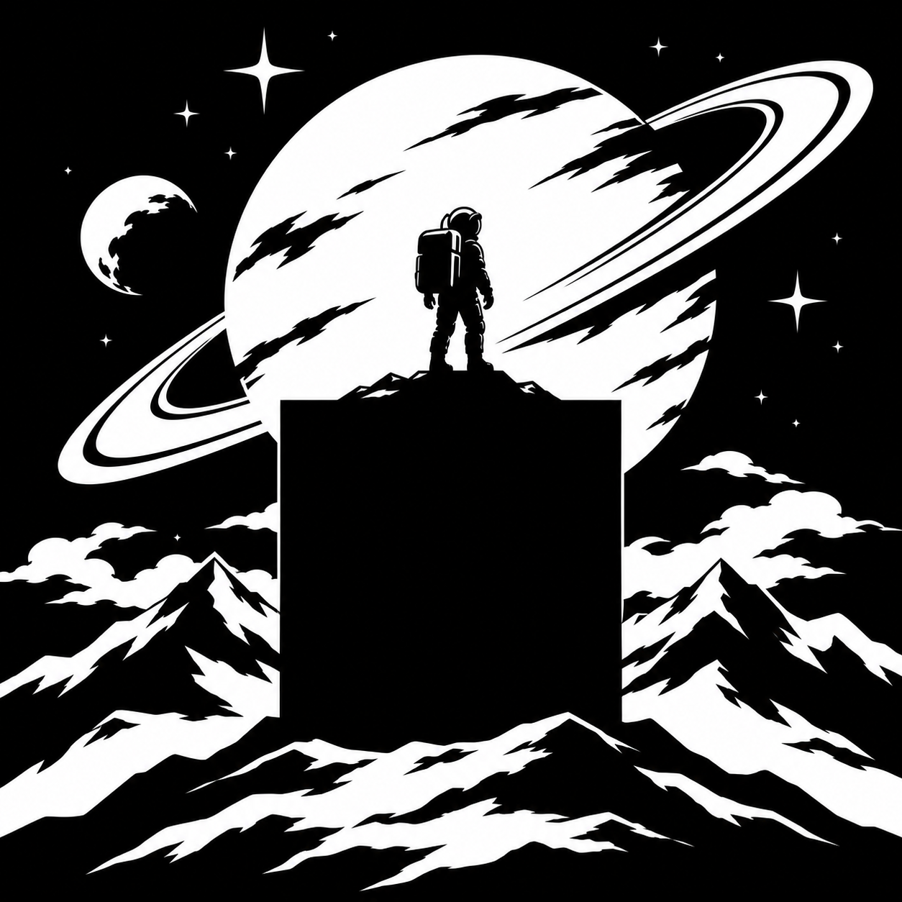
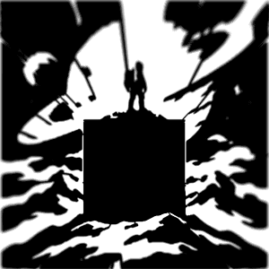

# Shadow Box — конструктор теневой лампы

Программа превращает чёрно-белое изображение в 3D-модель лампы: четыре фигурные стенки вокруг компактного источника света создают рисунок на окружающей стене. Доступны настольный интерфейс, веб-приложение и командная строка. Blender для генерации не нужен.

**Это геометрический прототип.** STL и расчётная проекция проверяются программно; реальная печать, нагрев светодиода и совпадение тени с расчётом физически не испытаны.

## Пример: астронавт

Исходник из комплекта примеров:



Расчётная тень с источником размером 2 мм:



[Сравнение исходника, идеальной тени, размытия и освещения](examples/astronaut/preview.png) · [STL сборки](examples/astronaut/radial-box.stl) · [Параметры и отчёт](examples/astronaut/report.json)

Пример рассчитан для основания **100 × 100 мм**, высоты источника **70 мм**, рисунка **600 × 600 мм**, стенок **2 мм**, сглаживания **0,8 мм** и детализации **180**. Центр короба смещён вниз на **14%** высоты картинки. LED остаётся в центре основания. Чёрный прямоугольник на исходнике больше основания: остальную его площадь формирует тень стенок.

Мелкие звёзды, полосы планеты и кольца частично теряются из-за минимальной толщины элементов и перемычек. Превью показывает этот эффект, а не обещает точное воспроизведение исходника. Иллюстрация включена как демонстрационный материал; отдельная лицензия на неё не заявлена.

## Возможности

- Загрузка PNG, JPEG и WebP, порог чёрного, инверсия и сохранение пропорций.
- Размеры короба и рисунка, смещение по X/Y, сглаживание и автоматические перемычки.
- Идеальная тень, размытие от конечного источника и оценка освещённости.
- Вращаемая 3D-модель, просмотр отдельных деталей, экспорт STL.
- Комплект из шести деталей под Creality K1 с соплом 0,4 мм: четыре стенки, основание и стойка. Сборка на клей, проверка габаритов.
- Настройки JSON и пресеты «Превью» / «Для печати».

## Быстрый запуск

Проверено на **Linux x86-64 и Python 3.14**. Версии зависимостей зафиксированы в `requirements*.txt`; другие платформы не проверялись.

```sh
git clone https://github.com/y-morgunov/shadow_box.git
cd shadow_box
python3.14 -m venv .venv
```

### Настольное приложение

```sh
.venv/bin/python -m pip install -r requirements-gui.txt
./start-gui.sh
```

Нужен графический сеанс с OpenGL. При старте доступен пример с астронавтом. Настройки сохраняются между запусками. [Инструкция GUI](GUI.md).

### Веб-приложение

```sh
.venv/bin/python -m pip install -r requirements-web.txt
```

Задайте `SHADOW_PASSWORD` (не менее 16 символов) и `SHADOW_ORIGIN=http://localhost:8080`, затем:

```sh
.venv/bin/python -m web.server
```

Откройте `http://localhost:8080`. Генерация выполняется на сервере; браузер показывает результат. Это приложение для одного владельца с общим паролем, без отдельных пользовательских аккаунтов. Для публикации предусмотрены Docker Compose и HTTPS reverse proxy: **[инструкция развёртывания](WEB.md)**. Docker-сборка и внешний HTTPS пока не проверены.

### Командная строка

```sh
.venv/bin/python -m pip install -r requirements.txt
.venv/bin/python radial_shadow.py examples/astronaut/input.png \
  --out output/astronaut --size 100 --height 70 --span 600 \
  --thickness 2 --resolution 180 --smoothing 0.8 \
  --source-diameter 2 --box-x 0 --box-y 14 --preview-pixels 300
```

Команда воспроизводит опубликованный пример. Для своего рисунка замените путь изображения. `--box-x` и `--box-y` задают положение центра основания в процентах размера картинки: плюс X — вправо, плюс Y — вниз. Все линейные размеры и STL — в миллиметрах.

В `output/astronaut/` появятся:

| Файл | Содержимое |
| --- | --- |
| `radial-box.stl` | Сборка для просмотра |
| `print-k1.zip` | Шесть деталей, инструкция сборки и отчёт |
| `projection-point.png` | Идеальная тень |
| `projection-finite.png` | Размытие от протяжённого источника |
| `projection-lighting.png` | Расчётная освещённость |
| `preview.png` | Сравнение с исходником |
| `request.json`, `report.json` | Параметры запуска и проверки |

Рабочие результаты и локальные настройки могут содержать пути к исходникам. Каталог `output/` и файлы `.env` исключены из Git; не публикуйте их без проверки.

## Свет и печать

Нужна компактная светящаяся область: крупный LED или матовая лампочка размывают рисунок. Направленность LED и расстояние до стены влияют на равномерность света. Отражатель-пирамида в текущем расчёте не реализован. Стойка имеет канал для проводов, но не является готовым креплением конкретной платы LED или радиатора.

Перед печатью проверьте STL в слайсере, ориентацию, поддержки и толщину деталей. Встроенный фильтр не гарантирует прочность каждого элемента. Не рассчитывайте тепловой режим по световому превью.

- [Геометрия и CLI](RADIAL.md)
- [Освещение и ограничения модели](LIGHTING.md)
- [Комплект для печати](PRINTING.md)
- [Настольный интерфейс](GUI.md)
- [Сервер и публикация](WEB.md)

`shadow_cube.py` и `blender_scene.py` содержат ранний вариант с фронтальным трафаретом. Основной режим проекта — `radial_shadow.py`; дополнительная визуализация в Blender — `blender_radial.py`.

## Разработка и проверки

```sh
.venv/bin/python -m unittest discover -v
```

Проверяются геометрия, замкнутость STL, настройки, HTTP API, настоящая генерация, экспорт, отмена и таймаут. Отдельные интеграционные проверки:

```sh
SHADOW_GUI_TEST=1 .venv/bin/python -m unittest test_gui -v
# Требует playwright и установленного Chromium; подробности в WEB.md.
SHADOW_BROWSER_TEST=1 .venv/bin/python -m unittest test_web_browser -v
```

Веб-сервис использует Python, браузерный просмотр — локальный WebGL без CDN. Настольный интерфейс построен на PySide6 и PyQtGraph; геометрия — на Trimesh, Manifold и Shapely.

## Лицензия

В репозитории сохранена [Apache License 2.0](LICENSE), выбранная при его создании. Демонстрационная иллюстрация предоставлена отдельно; её происхождение и отдельная лицензия не заявлены. Лицензии сторонних библиотек сохраняются у соответствующих проектов.
